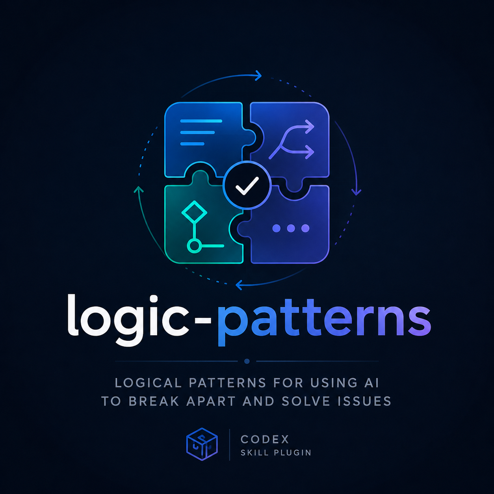

<div align="center">
  
  <br/>
  <a href="https://skills.sh/integrii/logic-patterns"></a>
</div>

# logic-patterns

Increasingly we, as technologists, are moving further and further from the nuts and bolts of our programs. Long ago, we stopped caring about the kernel instructions. Sometime after that, we stopped caring so much about memory allocation, garbage collection, or even sometimes, process forking and threading. It's not to say that you don't need to know these things sometimes, but you surely don't need to always consider all of them all the time. The layer in which we pay attention is ever creeping higher and higher.

Now, as we all collectively venture into the future where we can produce code 1,000 times faster, there are new higher-order abstractions coming to play. I'm not talking about AI skills directly here. I'm talking about _ways_ of thinking about problems. Logical strategies that are widely applicable. Logical patterns which allow us to take a problem space, drive order from chaos, isolate known from unknown, and move towards progress. Generically attacking issues with your experience is great, but I believe that there are common logical strategies that we can capture among all of our collective experience. Those logical strategies will enable us as technologists to advance into every sector of problems known to mankind. This is our new toolbelt.

I think the future AI takes us to goes beyond coding and organizing our calendars. I think AI can enable a skilled few to dismantle any solvable problem space systematically, at scale, in order to bend nature, and ultimately the universe, to mankind's advantage. After all, once robots are available and part of our realm, what problem can we not solve with enough iterative improvement?

## Install plugin bundles

Version [1.0.5](https://github.com/integrii/logic-patterns/releases/tag/v1.0.5) includes 18 skills in two Codex plugins:

- `logic-patterns`: Generic problem-solving and reasoning workflows for technologists.
- `development-patterns`: Effective engineering, execution, and implementation workflows.

### Install

```sh
codex plugin marketplace add integrii/logic-patterns@main

# Pick one plugin to install:
codex plugin add logic-patterns@logic-patterns
codex plugin add development-patterns@logic-patterns
```

## Plugin bundles

### [logic-patterns](https://github.com/integrii/logic-patterns/tree/main/plugins/logic-patterns/skills)

#### 1-3-1

Frame one problem and send the same brief to three independent proposal agents. Compare correctness, simplicity, risk, and effort, then select one implementation path.

#### adversary-loop

Review a complete plan or implementation with its requirements and validation evidence. Collect all significant findings in one ledger, repair the batch, and repeat full-surface review until a fresh pass is clean.

#### bifurcate

Split a complex issue into two competing causes and follow one branch to a concrete fix. Validate the original issue, then revisit untried branches until it is resolved.

#### first-principles-rebuild

Derive required outcomes and invariants from the specification before inspecting implementation constraints. Define a simpler target design and turn it into a concrete reimplementation plan.

#### five-whys

Investigate the symptom before building an evidence-backed chain of exactly five why questions. Answer each with a `Because:` line and resolve or bound unknowns before moving deeper.

#### session-review

Turn repeated session discoveries into reusable skill guidance. Extend an existing skill when it owns the workflow and create a focused skill only when the scope is distinct.

#### gaslight-loop

Challenge the current diff, plan, or named files with repeated local bug reviews. Fix significant findings and run focused validation until none remain.

#### greyhat

Review trust boundaries, authentication, authorization, secrets, injection, and other security surfaces. Repair confirmed risks and repeat until no unresolved high or critical findings remain.

#### make-a-plan

Create a small plan around a named outcome and the existing canonical codepath. Use one bounded expansion pass and one simplification pass, then finish at code, focused tests, and implementation review. Shipping and deployment belong to a later pipeline.

#### multidimensional-planning

Explore a broad objective across useful independent dimensions such as user journeys, contracts, data, security, and validation. Turn each answer into plan tasks and resolve conflicts before implementation.

### [development-patterns](https://github.com/integrii/logic-patterns/tree/main/plugins/development-patterns/skills)

#### architecture-decision-records

Keep user-decided architecture choices in repository-local `ADR.md`. Load those decisions before design work and keep incidental implementation notes elsewhere.

#### architecture-spec

Define cross-service ownership, authority, boundaries, and compatibility in the workspace architecture document. Keep concrete service behavior in each owning repository's `SPEC.md`.

#### centralized-fix-selection

Find the narrowest shared control point for behavior that spans multiple callers. Prefer a centralized policy or shared fix when safe and preserve external behavior unless the requested outcome requires a change.

#### ephemeral-testing

Run a reproducible multi-service test stack in one session-owned namespace. Require `STACK_ID` to equal `CODEX_THREAD_ID`, isolate outputs and resources, check readiness, and clean up between runs.

#### github-release-builds

Build multi-architecture container images in GitHub Actions on semver tags and publish them to GHCR. Update example manifests, attach image release evidence, and document the tag-only release process in `RELEASE.md`.

#### implement-plan

Execute an active plan through focused tests, a completion ledger, local review, and a clean adversary loop. Use GPT-6 Astra with medium reasoning for independent reviewers unless the user chooses otherwise. Close only after the final diff and required acceptance gates are verified.

#### plan-checklists

Track implementation work with concise Markdown checklists and the repository's storage policy. Keep PersonaStack plans in the workspace root `.plans/` tree and archive inactive plans promptly. Keep shipping procedures outside implementation plans.

#### spec-driven-development

Define desired behavior, contracts, and implementation constraints in repository-local `SPEC.md`. Keep service specs aligned with accepted architecture and use them to guide implementation and validation.
